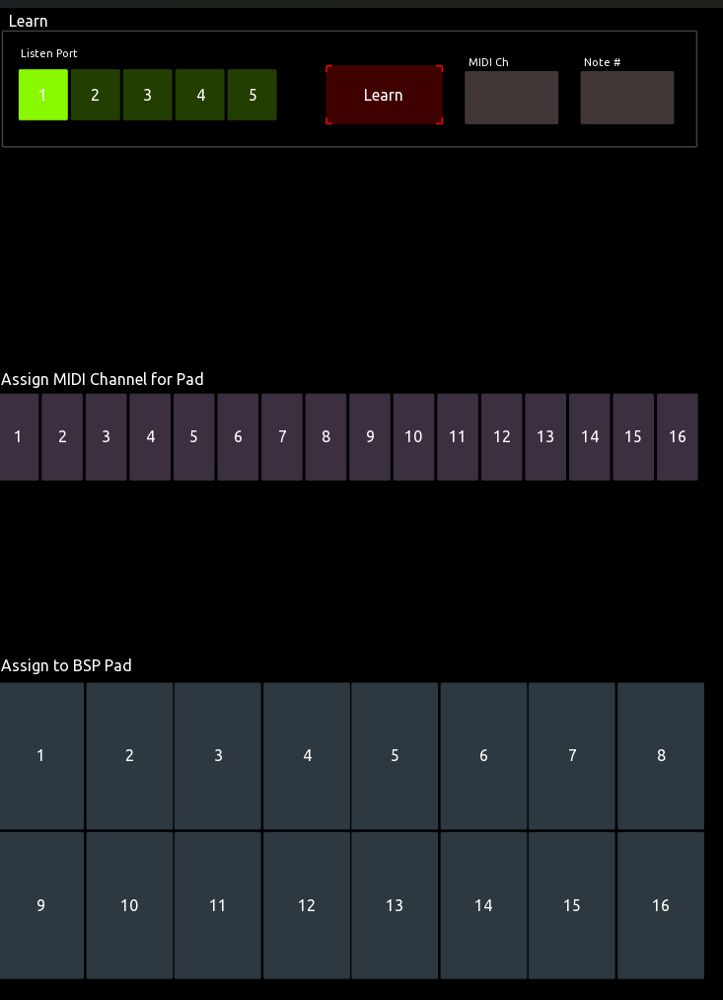

# BSP-DrumMap

A TouchOSC panel for editing the **Custom drum map** on an Arturia BeatStep Pro.
Play a note on any MIDI device to learn its note number and channel, then tap a
pad button to assign that note and channel to the matching BeatStep Pro drum pad.

## Requirements

- [TouchOSC](https://hexler.net/touchosc) (the current version, not TouchOSC Mk1)
- An Arturia BeatStep Pro connected over USB or MIDI
- Optional: a MIDI controller or DAW to send the notes you want to learn

## Setup

Open `BSP-DrumMap.tosc` in TouchOSC and set up the MIDI connections under
**Connections > MIDI**:

| Connection | Direction | Used for |
|---|---|---|
| 1 | Output → BeatStep Pro | Sysex messages that program the drum map |
| 1–5 | Input | Learning notes; the **Listen Port** selector picks which connection is used |

Connection 1 can be both the BeatStep Pro output and one of the learn inputs.

## Usage

1. **Pick a listen port.** Select a connection (1–5) under **Listen Port**.
2. **Learn a note.** Tap **Learn**. The button flashes while learn mode is on.
   Play a note on a device connected to the selected port. The panel captures
   the first Note On, fills in **Note #** and **MIDI Ch**, selects the matching
   channel button, and ends learn mode.
   - Tap **Learn** again to cancel.
   - Learn mode ends automatically after 10 seconds.
   - You can also select a channel by hand under **Assign MIDI Channel for Pad** (1–16).
3. **Assign to a pad.** Tap a pad button (1–16) under **Assign to BSP Pad**. If a valid note (0–127) and a
   channel are set, the panel sends the assignment to the BeatStep Pro. A
   status message ("Pad X assigned note YY, CH ZZ") appears and fades out over
   5 seconds, and the note, channel and channel selection are cleared for the
   next assignment.

The first assignment after the panel opens also switches the BeatStep Pro's
drum map to **Custom**, so the new assignments take effect. This is sent only
once per session.

## Sources

BeatStep Pro sysex spec (Custom drum map messages):
https://github.com/Pl0p/Beatstep-pro-Sysex/blob/main/Sysex%20Device%20Setting.txt
